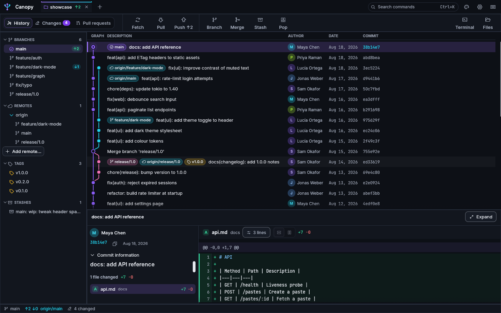

<p align="center">
  
</p>

<h1 align="center">Canopy</h1>

<p align="center">A fast, beautiful, Linux-first Git client.</p>

<p align="center">
  <a href="https://github.com/NecturaLabs/Canopy/actions/workflows/ci.yml"></a>
  <a href="#licence"></a>
  <a href="https://canopy.necturalabs.com">Website</a>
</p>

Canopy is a native desktop Git client for Linux, macOS and Windows, written in Rust. It reads
repositories directly through libgit2, so the commit graph, status and diffs appear immediately
and stay responsive on large histories. Every change it makes runs through your own `git`
executable, so credential helpers, SSH keys and config, hooks, commit signing, Git LFS and proxies
work exactly as they do in the terminal.

It borrows from the clients people already like: the speed and layout of Fork, the visual commit
graph and command palette of GitKraken, and the breadth of operations of Sourcetree.

## Screenshots




Screenshots are rendered by Canopy itself from the deterministic fixture repository
(`tools/mkfixture.sh` and `tools/screenshot.sh`), at 1440×900 and 100% interface zoom.

## Features

- **Repositories**: welcome screen with recent repositories; open, clone (with live progress; an
  `owner/repo` field for GitHub and GitLab builds the HTTPS or SSH address) and init; several
  repositories open at once in tabs, restored on the next start. Partial clones
  (`--filter=blob:none`, `--filter=tree:0`) download the objects a view needs through `git` on
  demand.
- **History**: commit graph with coloured lanes and curved merge edges, ref labels for `HEAD`,
  local and remote branches and tags, profile pictures with initials fallback, relative dates, and filtering by message,
  author or SHA.
- **Commit details**: metadata, parents, changed files with added/removed line counts and a diff
  per file.
- **Working copy**: unstaged, staged and conflicted files; stage, unstage and discard per file, for
  everything, per hunk or per line; unified or side-by-side diffs with syntax highlighting, old
  and new line numbers, and settings for context lines and whitespace (global, with per-repository
  overrides).
- **Conflicts**: a three-way resolver (take ours, theirs, both or the common ancestor, or edit by
  hand) and merge modes (default, no fast-forward, fast-forward only, squash).
- **Committing**: summary and description fields with a character counter, amend and optional
  `--signoff`.
- **Branches**: create (from any commit), checkout, rename, delete (`git branch -d` first; Canopy
  offers to force only when Git refuses), merge into the current branch, rebase the current branch
  onto another, ahead/behind badges, and checkout of remote branches as tracking branches.
- **Remotes**: fetch (all remotes, with prune, optionally every few minutes), pull (following your
  git config, else the strategy chosen in Settings), push (sets the upstream when missing;
  optional force-with-lease). A repository without a remote is shown as local only and offers
  Publish, which adds a remote and pushes.
- **Tags and stashes**: lightweight and annotated tags with push and delete; stash save (with a
  message, optionally including untracked files), apply, pop and drop.
- **Commit actions**: checkout (detached), new branch or tag here, cherry-pick, revert, reset the
  current branch here (soft, mixed or hard), copy SHA or message.
- **In-progress operations**: a banner for merge, rebase and cherry-pick with continue and abort.
- **GitHub and GitLab**: open a commit, branch or remote on its host, and list, read, create,
  check out, comment on, approve, merge and close pull and merge requests (self-hosted GitLab
  included) through the host's API (REST, and one GraphQL query for the list's checks and
  reviews) with the sign-in of the GitHub CLI (`gh`) or GitLab CLI (`glab`); Canopy stores no token. Requests and the update check are the only network use
  besides `git`, and each has an off switch; see the
  [privacy policy](docs/legal/privacy-policy.md).
- **Credentials**: git and ssh ask for passwords, passphrases and host-key confirmation in Canopy's
  own dialog, never in a terminal.
- **Workflow**: command palette for every command and branch checkout, keyboard shortcuts with a
  cheatsheet, toasts that carry git's own error output, automatic refresh on file changes and
  window focus, status bar with branch, ahead/behind, repository state and the running job.
- **Appearance and settings**: three themes, Midnight (the default), Daylight and Observatory, a
  Custom theme (Midnight or Daylight with your own accent and tint), a
  High contrast switch that works with each, a choice of graph marks and lines, interface zoom,
  reduced motion, and a settings screen (Ctrl+,) for appearance, Git, integrations, accounts,
  updates and privacy.
- **Diagnostics and privacy**: structured per-run logs and local crash reports in Canopy's data
  folder; opt-in, scrubbed crash reports to NecturaLabs after you accept the Terms and Privacy
  Policy and answer the question. The update check can be turned off.

Destructive operations (discard, hard reset, deleting a branch or tag, dropping a stash, force
push) always ask for confirmation. The full matrix, including what is planned, is in
[docs/features.md](docs/features.md).

## Install

One command installs Canopy for the current user, with no `sudo` or administrator rights, and
running it again upgrades in place.

Linux and macOS:

```sh
curl -fsSL https://raw.githubusercontent.com/NecturaLabs/app-updates/main/canopy/install.sh | sh
```

Windows (PowerShell):

```powershell
irm https://raw.githubusercontent.com/NecturaLabs/app-updates/main/canopy/install.ps1 | iex
```

There is no stable release yet, so these stop with an error saying the release has no build for
your system. Until the first one, install the beta build, which ships Linux builds only for now:

```sh
curl -fsSL https://raw.githubusercontent.com/NecturaLabs/app-updates/main/canopy/install.sh | sh -s -- --beta
```

The installer reads Canopy's update manifest, downloads the build for your system over HTTPS,
checks its SHA-256 against the manifest and refuses anything that does not match. It never asks
for elevated rights and never installs git; it tells you whether `git` and `git-lfs` are present
and how to install them. Options: `--beta` (beta builds), `--version N` (a build number such as 412), `--no-path`,
`--uninstall` (`--purge` also deletes settings and logs), `--help`; on Windows `-Beta`,
`-Version N`, `-NoPath`, `-Uninstall`, `-Purge`, `-Help`.

Canopy gets a folder of its own:

| | Installed to | Also created |
|---|---|---|
| Linux | `~/.local/opt/canopy/` (`bin/canopy`, icons, desktop entry, metainfo, licence and notices, `uninstall.sh`) | `~/.local/bin/canopy` (a symlink), the launcher entry and icons under `~/.local/share/applications` and `~/.local/share/icons` |
| macOS | `~/Applications/Canopy.app` | `~/.local/bin/canopy` (a symlink) |
| Windows | `%LOCALAPPDATA%\Programs\Canopy\` (`canopy.exe`, notices, `uninstall.ps1`) | a Start Menu shortcut, an entry in Apps & features, the folder on your user `PATH` |

To uninstall, run `~/.local/opt/canopy/uninstall.sh` on Linux, use Apps & features on Windows,
or run the installer with the option:

```sh
curl -fsSL https://raw.githubusercontent.com/NecturaLabs/app-updates/main/canopy/install.sh | sh -s -- --uninstall
```

```powershell
& ([scriptblock]::Create((irm https://raw.githubusercontent.com/NecturaLabs/app-updates/main/canopy/install.ps1))) -Uninstall
```

Uninstalling removes exactly what the installer created (files of your own in its folder stay);
your settings and logs stay unless you add `--purge`. Re-running never replaces a newer installed
version with an older one unless you ask with `--version`. Builds exist for Linux x86_64 (glibc 2.35 or newer, e.g. Ubuntu 22.04),
macOS on Apple silicon and Windows x64; Linux arm64 and Intel Macs are being added. Details:
[packaging/README.md](packaging/README.md).

## Install from source

Requirements:

- A stable Rust toolchain (1.91 or newer) from [rustup](https://rustup.rs), with rustfmt and
  clippy. Canopy builds with the latest stable release; no exact release is pinned.
- `git` 2.30 or newer on `PATH` at runtime.
- A C compiler (libgit2 is built from source by the `git2` crate). No OpenSSL or libssh2 is needed.
- Linux: a Wayland or X11 session with OpenGL 3.3 or OpenGL ES 3.0, plus an XDG desktop portal for
  the folder picker (installed by default on GNOME, KDE and most other desktops; on Hyprland,
  whose own portal has no file chooser, install `xdg-desktop-portal-gtk`).

Linux runtime libraries:

```sh
# Debian / Ubuntu
sudo apt install build-essential pkg-config libxkbcommon0 libxkbcommon-x11-0 libgl1 libegl1 git
# Fedora
sudo dnf install gcc pkgconf-pkg-config libxkbcommon libxkbcommon-x11 mesa-libGL mesa-libEGL git
# Arch
sudo pacman -S --needed base-devel libxkbcommon libxkbcommon-x11 libglvnd mesa git
```

Build and run (the component library, `crates/nectura-ui`, is a submodule of
[`NecturaLabs/nectura-ui`](https://github.com/NecturaLabs/nectura-ui); `git submodule update --init`
fetches it in an existing clone):

```sh
git clone --recurse-submodules https://github.com/NecturaLabs/Canopy.git
cd Canopy
cargo run --release -p canopy-app -- /path/to/repo
```

To install the binary, desktop entry and icons for your user on Linux (`~/.local/bin` must be on
`PATH`):

```sh
tools/install-desktop.sh            # tools/install-desktop.sh --uninstall to remove
```

## Quick start

1. Install Canopy (above) and open a repository: `canopy ~/code/my-project`, or pick one from the
   welcome screen.
2. Read the history in the commit graph; select a commit to see its files and diff.
3. Open Changes, stage files with Space (or everything with Ctrl+Shift+S), write a message and
   commit with Ctrl+Enter.
4. Push with Ctrl+Shift+P. Ctrl+K opens the command palette and `?` lists every shortcut
   ([docs/keybindings.md](docs/keybindings.md)).

## Usage

```text
canopy [OPTIONS] [PATH]...
```

Each `PATH` opens as a tab; Canopy searches upward from it for the repository root. Without a
path, the welcome screen lists recent repositories.

| Option | Effect |
|---|---|
| `--light` | Start with the Daylight theme. |
| `--theme <THEME>` | Start with a theme: `midnight`, `daylight`, `observatory` or `custom`. |
| `--custom-theme <SPEC>` | The custom theme's colours, comma-separated `key=value`: `base=midnight\|daylight`, `accent=0-359` (hue), `intensity=20-140`, `tint-hue=0-359`, `tint=0-100`. Missing keys keep Midnight's own colours; it shows with `--theme custom`. |
| `--contrast <on\|off>` | Start with High contrast on or off. |
| `--view <history\|changes\|requests>` | Initial view. |
| `--split` | Show diffs side by side. |
| `--overlay <NAME>` | Open an overlay (for screenshots): `settings`, `privacy`, `cheatsheet`, `palette`, `consent`, `crash-consent`, `legal`, `licences`, `credential`, `host-key` or `merge`. |
| `--size <WxH>` | Initial window size (default `1440x900`). |
| `--screenshot <FILE.png>` | Capture a PNG and exit. Use `tools/screenshot.sh`; direct invocation is refused without the isolated screenshot environment. |
| `-h`, `--help` / `-V`, `--version` | Help and version. |

Each run writes a JSON-lines log to `logs/` in Canopy's state folder (`~/.local/state/canopy` on
Linux) and the same events to stderr. Set `CANOPY_LOG` (or `RUST_LOG`), for example
`CANOPY_LOG=canopy=debug`, to choose the level; it overrides Settings → Privacy → Log detail.

### Keyboard shortcuts

Ctrl+K opens the command palette, `?` (or Ctrl+/) the cheatsheet, and Settings → Keyboard lists
every binding. A few to start with:

| Shortcut | Action |
|---|---|
| Ctrl+K | Command palette |
| `?` | Keyboard shortcuts |
| Ctrl+O / Ctrl+Shift+N | Open / clone repository |
| Ctrl+W, Ctrl+Tab, Ctrl+1…9 | Close tab, next tab, go to tab N |
| `1` / `2` / `3` | History / Changes / pull and merge requests |
| `j` / `k`, `gg` / `G` | Move the selection, first / last |
| `f` / `p` / `P` | Fetch / pull / push |
| Ctrl+Enter | Commit (in Changes) |

Bare keys never fire while a text field has focus, and Super is never bound. The whole table is in
[docs/keybindings.md](docs/keybindings.md).

## Architecture

Three crates:

- **`canopy-core`**: the UI-agnostic Git backend. Repository snapshots, commit graph lane layout,
  diffs, status and local reads through libgit2 (`git2`, built without network transports);
  every mutation and all Git network traffic through the `git` CLI. It also parses GitHub and
  GitLab remote URLs (`forge.rs`, offline).
- **`canopy-hosting`**: the GitHub and GitLab API client (pull and merge requests through REST
  and one GraphQL query, `ureq` with rustls) and the update-manifest fetch. It contacts only the
  host a repository's own remote points at, with the token the `gh` or `glab` CLI holds, in memory only; author images use the
  restricted picture hosts listed in the Privacy Policy, without credentials.
- **`canopy-app`**: the GUI, built on `eframe`/`egui` with the glow (OpenGL) renderer. Each open
  repository has a background worker thread; the UI thread sends it jobs and never calls git.

See [docs/architecture.md](docs/architecture.md) for the threading model, the graph layout
algorithm and the reasoning behind libgit2 plus the CLI, and [docs/design.md](docs/design.md) for
the visual design system.

## Development

```sh
cargo fmt --all
cargo clippy --workspace --all-targets --locked -- -D warnings
cargo test --workspace --locked
cargo run -p canopy-app -- <repo>
tools/check.sh                       # fmt, clippy, tests, release, notices, docs and stall checks, installer test
tools/mkfixture.sh /tmp/demo         # deterministic demo repository
tools/screenshot.sh /tmp/demo out.png --view changes
```

Never point Canopy at a repository you care about while testing destructive operations; use a
fixture from `tools/mkfixture.sh`. See [CONTRIBUTING.md](CONTRIBUTING.md) for the commit
convention and pull request checklist, and [GitHub Issues](https://github.com/NecturaLabs/Canopy/issues) for planned work.

## Project layout

```text
.
├── crates/
│   ├── canopy-core/        Git backend: snapshots, graph layout, diffs, status, operations,
│   │                       git-flow, ignore rules, LFS, submodules, forge URLs, conflicts
│   ├── canopy-hosting/     GitHub and GitLab API client and the update-manifest fetch
│   ├── canopy-app/         GUI binary `canopy`
│   │   ├── assets/         window icon
│   │   └── src/            main, app/, worker, tab, settings, keymap, hosting, askpass, ui/, views/
│   └── nectura-ui/         component library (submodule): theme, fonts, motion, components
├── assets/                 application icon (PNG)
├── docs/                   architecture, design system, feature matrix, keybindings,
│                           ADRs, specs, legal texts, screenshots
├── packaging/              one-line installers and their test; Linux desktop entry, macOS bundle
├── site/                   landing site (canopy.necturalabs.com)
├── vendor/                 eframe with Canopy's patch (tools/vendor-eframe.sh)
├── tools/                  check, fixture, screenshot, install, release and stress scripts
├── .claude/, .codex/,      agents and skills for AI coding agents
│   .agents/
└── .github/                CI, release workflows, templates
```

## Working with AI agents

The repository is set up for coding agents. [AGENTS.md](AGENTS.md) (loaded by Claude Code through
`CLAUDE.md`) holds the commands, workflow, conventions and boundaries.

- **Agents** (`.claude/agents/`): `canopy-review` (read-only diff review), `canopy-git` (Git
  semantics and canopy-core operations), `canopy-visual-qa` (renders the app headlessly and
  reports visual defects), `canopy-ux-research` (how other Git clients solve a UX question).
- **Skills** (`.claude/skills/`): project recipes (`screenshot`, `fixture-repo`, `add-git-operation`,
  `hosting-api`, `add-theme`, `add-keybinding`, `release`) and working-method skills
  (`independent-review`, `testing`, `project-docs`, `memory-hygiene`, `agent-instructions`,
  `agent-orchestration`).
- **Tools** (`tools/`): the scripts above let an agent build, check, create a reproducible
  repository and look at the result as an image.

## Community

- [Contributing](CONTRIBUTING.md): how to propose and make a change, and what fits Canopy.
- [Discussions](https://github.com/NecturaLabs/Canopy/discussions) and [SUPPORT.md](SUPPORT.md):
  questions and ideas.
- [Code of conduct](CODE_OF_CONDUCT.md), [governance](GOVERNANCE.md) and the
  [roadmap](docs/roadmap.md).
- [Security policy](SECURITY.md): report vulnerabilities privately.
- [Accessibility](ACCESSIBILITY.md), [changelog](CHANGELOG.md) and
  [releases](https://github.com/NecturaLabs/Canopy/releases).

## Licence

Canopy is licensed under either of

- the [Apache License, Version 2.0](LICENSE-APACHE), or
- the [MIT License](LICENSE-MIT),

at your option. Copyright (c) 2026 NecturaLabs.

Unless you explicitly state otherwise, any contribution you intentionally submit for inclusion in
Canopy, as defined in the Apache-2.0 licence, is dual licensed as above, without any additional
terms or conditions.

Bundled fonts are under the SIL Open Font License 1.1 (`crates/nectura-ui/assets/fonts/`);
third-party crates are under their own licences (`docs/legal/third-party-notices.txt`). The
Canopy name and icon identify NecturaLabs' builds; a fork you distribute should use its own.
