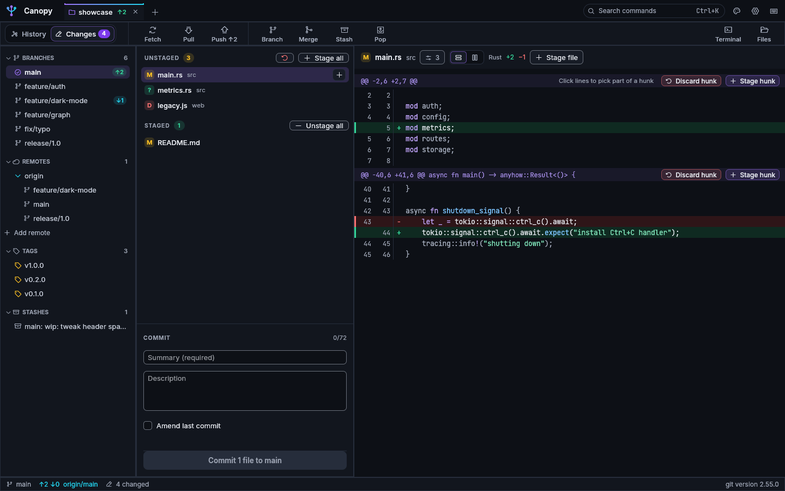
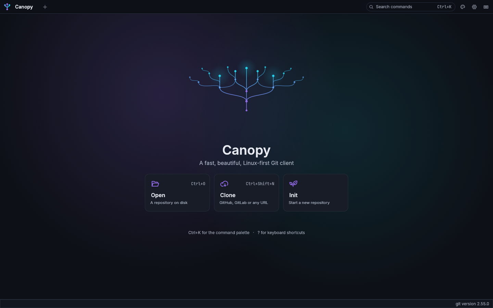
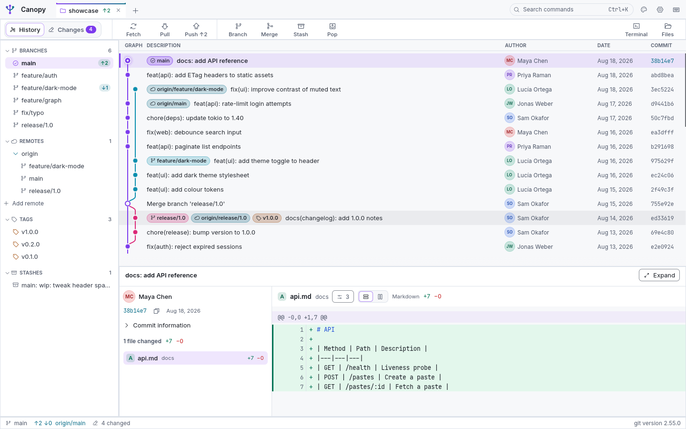

<p align="center">
  
</p>

<h1 align="center">Canopy</h1>

<p align="center">A fast, beautiful, Linux-first Git client.</p>

Canopy is a native desktop Git client for Linux, macOS and Windows, written in Rust. It reads
repositories directly through libgit2, so the commit graph, status and diffs appear immediately
and stay responsive on large histories. Every change it makes runs through your own `git`
executable, so credential helpers, SSH keys and config, hooks, commit signing, Git LFS and proxies
work exactly as they do in the terminal.

It borrows from the clients people already like: the speed and layout of Fork, the visual commit
graph and command palette of GitKraken, and the breadth of operations of Sourcetree.

## Screenshots








Screenshots are rendered by Canopy itself from the deterministic fixture repository
(`tools/mkfixture.sh` and `tools/screenshot.sh`).

## Features

- **Repositories**: welcome screen with recent repositories; open, clone (with live progress) and
  init; several repositories open at once in tabs.
- **History**: commit graph with coloured lanes and curved merge edges, ref labels for `HEAD`,
  local and remote branches and tags, author avatars, relative dates, and filtering by message,
  author or SHA.
- **Commit details**: metadata, parents, changed files with added/removed line counts and a diff
  per file.
- **Working copy**: unstaged, staged and conflicted files; stage, unstage and discard per file, for
  everything, or per hunk; diff viewer with old and new line numbers.
- **Committing**: summary and description fields with a character counter, and amend.
- **Branches**: create (from any commit), checkout, rename, delete, merge into the current branch,
  rebase the current branch onto another, ahead/behind badges, and checkout of remote branches as
  tracking branches.
- **Remotes**: fetch (all remotes, with prune), pull (fast-forward or rebase, following your git
  config), push (sets the upstream when missing; optional force-with-lease).
- **Tags and stashes**: lightweight and annotated tags with push and delete; stash save (with a
  message, optionally including untracked files), apply, pop and drop.
- **Commit actions**: checkout (detached), new branch or tag here, cherry-pick, revert, reset the
  current branch here (soft, mixed or hard), copy SHA or message.
- **In-progress operations**: a banner for merge, rebase and cherry-pick with continue and abort.
- **Workflow**: command palette for every command and branch checkout, keyboard shortcuts, toasts,
  automatic refresh on file changes and window focus, status bar with branch, ahead/behind, repository
  state and the running job.
- **Appearance**: dark "Midnight" theme (default) and light "Daylight" theme.

Destructive operations (discard, hard reset, deleting a branch or tag, dropping a stash, force
push) always ask for confirmation. The full matrix, including what is planned, is in
[docs/features.md](docs/features.md).

## Install

One command installs Canopy for the current user, with no `sudo` or administrator rights, and
running it again upgrades in place.

Linux and macOS:

```sh
curl -fsSL https://raw.githubusercontent.com/NecturaLabs/app-updates/main/canopy/install.sh | sh
```

Windows (PowerShell):

```powershell
irm https://raw.githubusercontent.com/NecturaLabs/app-updates/main/canopy/install.ps1 | iex
```

These work from the first stable release that ships the installers. Until then the addresses
answer 404: `curl` reports the error, but `sh` gets an empty script and exits without a word.

The installer reads Canopy's update manifest, downloads the build for your system over HTTPS,
checks its SHA-256 against the manifest and refuses anything that does not match. It never asks
for elevated rights and never installs git; it tells you whether `git` and `git-lfs` are present
and how to install them. Options: `--beta` (pre-releases), `--version X`, `--no-path`,
`--uninstall` (`--purge` also deletes settings and logs), `--help`; on Windows `-Beta`,
`-Version X`, `-NoPath`, `-Uninstall`, `-Purge`, `-Help`.

Canopy gets a folder of its own:

| | Installed to | Also created |
|---|---|---|
| Linux | `~/.local/opt/canopy/` (`bin/canopy`, icons, desktop entry, metainfo, licence and notices, `uninstall.sh`) | `~/.local/bin/canopy` (a symlink), the launcher entry and icons under `~/.local/share/applications` and `~/.local/share/icons` |
| macOS | `~/Applications/Canopy.app` | `~/.local/bin/canopy` (a symlink) |
| Windows | `%LOCALAPPDATA%\Programs\Canopy\` (`canopy.exe`, notices, `uninstall.ps1`) | a Start Menu shortcut, an entry in Apps & features, the folder on your user `PATH` |

To uninstall, run `~/.local/opt/canopy/uninstall.sh` on Linux, use Apps & features on Windows,
or run the installer with the option:

```sh
curl -fsSL https://raw.githubusercontent.com/NecturaLabs/app-updates/main/canopy/install.sh | sh -s -- --uninstall
```

```powershell
& ([scriptblock]::Create((irm https://raw.githubusercontent.com/NecturaLabs/app-updates/main/canopy/install.ps1))) -Uninstall
```

Uninstalling removes exactly what the installer created (files of your own in its folder stay);
your settings and logs stay unless you add `--purge`. Re-running never replaces a newer installed
version with an older one unless you ask with `--version`. Builds exist for Linux x86_64 (glibc 2.35 or newer, e.g. Ubuntu 22.04),
macOS on Apple silicon and Windows x64; Linux arm64 and Intel Macs are being added. Details:
[packaging/README.md](packaging/README.md).

## Install from source

Requirements:

- A Rust toolchain (stable, 1.91 or newer) from [rustup](https://rustup.rs). `rust-toolchain.toml`
  selects the stable channel with rustfmt and clippy.
- `git` 2.30 or newer on `PATH` at runtime.
- A C compiler (libgit2 is built from source by the `git2` crate). No OpenSSL or libssh2 is needed.
- Linux: a Wayland or X11 session with OpenGL 3.3 or OpenGL ES 3.0, plus an XDG desktop portal for
  the folder picker (installed by default on GNOME, KDE and most other desktops).

Linux runtime libraries:

```sh
# Debian / Ubuntu
sudo apt install build-essential pkg-config libxkbcommon0 libxkbcommon-x11-0 libgl1 libegl1 git
# Fedora
sudo dnf install gcc pkgconf-pkg-config libxkbcommon libxkbcommon-x11 mesa-libGL mesa-libEGL git
# Arch
sudo pacman -S --needed base-devel libxkbcommon libxkbcommon-x11 libglvnd mesa git
```

Build and run:

```sh
git clone https://github.com/NecturaLabs/Canopy.git
cd Canopy
cargo run --release -p canopy-app -- /path/to/repo
```

To install the binary, desktop entry and icons for your user on Linux (`~/.local/bin` must be on
`PATH`):

```sh
tools/install-desktop.sh            # tools/install-desktop.sh --uninstall to remove
```

## Usage

```text
canopy [OPTIONS] [PATH]
```

`PATH` opens that repository; Canopy searches upward from it for the repository root. Without a
path, the welcome screen lists recent repositories.

| Option | Effect |
|---|---|
| `--light` | Start in the light theme. |
| `--view <history\|changes>` | Initial view. |
| `--size <WxH>` | Initial window size (default `1440x900`). |
| `--screenshot <FILE.png>` | Render the window once the repository has loaded, save a PNG and exit. Used by `tools/screenshot.sh`. |
| `-h`, `--help` / `-V`, `--version` | Help and version. |

Logging goes to stderr. Set `CANOPY_LOG` (or `RUST_LOG`), for example `CANOPY_LOG=canopy=debug`.

### Keyboard shortcuts

| Shortcut | Action |
|---|---|
| Ctrl+K, Ctrl+Shift+P | Command palette |
| Ctrl+O | Open repository |
| Ctrl+Shift+N | Clone repository |
| Ctrl+W | Close tab |
| Ctrl+Tab / Ctrl+Shift+Tab | Next / previous tab |
| Ctrl+1 / Ctrl+2 | History / Changes |
| F5, Ctrl+R | Refresh |
| Ctrl+Shift+F | Fetch |
| Ctrl+Shift+L | Pull |
| Ctrl+Shift+K | Push |
| Ctrl+B | New branch |
| Ctrl+Shift+S | Stash |
| Ctrl+Enter | Commit (in Changes) |
| Ctrl+F | Filter history |
| Up / Down, J / K | Move selection |
| Esc | Close dialogs and the palette |
| Ctrl+, | Settings |
| Ctrl+= / Ctrl+- | Zoom in / out |

## Architecture

Two crates:

- **`canopy-core`**: the UI-agnostic Git backend. Repository snapshots, commit graph lane layout,
  diffs, status and local operations through libgit2 (`git2`, built without network transports);
  clone, fetch, pull, push, merge, rebase and hunk application through the `git` CLI.
- **`canopy-app`**: the GUI, built on `eframe`/`egui` with the glow (OpenGL) renderer. Each open
  repository has a background worker thread; the UI thread sends it jobs and never calls git.

See [docs/architecture.md](docs/architecture.md) for the threading model, the graph layout
algorithm and the reasoning behind libgit2 plus the CLI, and [docs/design.md](docs/design.md) for
the visual design system.

## Development

```sh
cargo fmt --all
cargo clippy --workspace --all-targets -- -D warnings
cargo test --workspace
cargo run -p canopy-app -- <repo>
tools/check.sh                       # fmt check, clippy and tests, as CI runs them
tools/mkfixture.sh /tmp/demo         # deterministic demo repository
tools/screenshot.sh /tmp/demo out.png --view changes
```

Never point Canopy at a repository you care about while testing destructive operations; use a
fixture from `tools/mkfixture.sh`. See [CONTRIBUTING.md](CONTRIBUTING.md) for the commit
convention and pull request checklist, and [docs/backlog.md](docs/backlog.md) for planned work.

## Project layout

```text
.
├── crates/
│   ├── canopy-core/        Git backend: snapshots, graph layout, diffs, status, operations
│   │   └── src/            lib, error, model, repo, graph, diff, status, ops, cli
│   └── canopy-app/         GUI binary `canopy`
│       ├── assets/         bundled fonts (OFL) and window icon
│       └── src/            main, app, worker, settings, ui/, views/
├── assets/                 application icon (SVG and PNG)
├── docs/                   architecture, design system, feature matrix, backlog, screenshots
├── packaging/linux/        desktop entry and AppStream metainfo
├── tools/                  check, fixture, screenshot and install scripts
├── .claude/                agents and skills for AI coding agents
└── .github/                CI, release workflow, templates
```

## Working with AI agents

The repository is set up for coding agents. [AGENTS.md](AGENTS.md) (loaded by Claude Code through
`CLAUDE.md`) holds the commands, workflow, conventions and boundaries.

- **Agents** (`.claude/agents/`): `canopy-review` (read-only diff review), `canopy-git` (Git
  semantics and canopy-core operations), `canopy-visual-qa` (renders the app headlessly and
  reports visual defects), `canopy-ux-research` (how other Git clients solve a UX question).
- **Skills** (`.claude/skills/`): `screenshot`, `fixture-repo`, `add-git-operation`, `release`.
- **Tools** (`tools/`): the scripts above let an agent build, check, create a reproducible
  repository and look at the result as an image.

## Licence

Proprietary. Copyright (c) 2026 NecturaLabs. All rights reserved. See [LICENSE](LICENSE). Bundled
fonts are under the SIL Open Font License 1.1; third-party crates are under their own licences.
